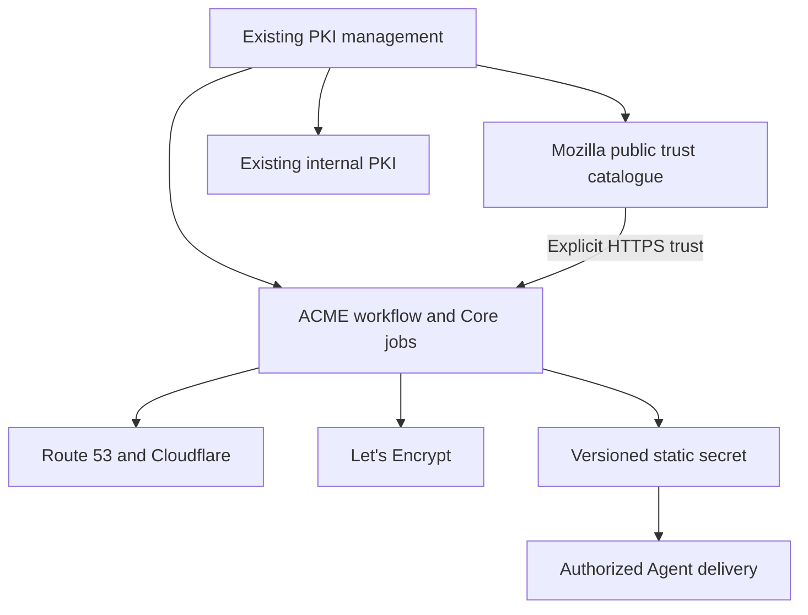
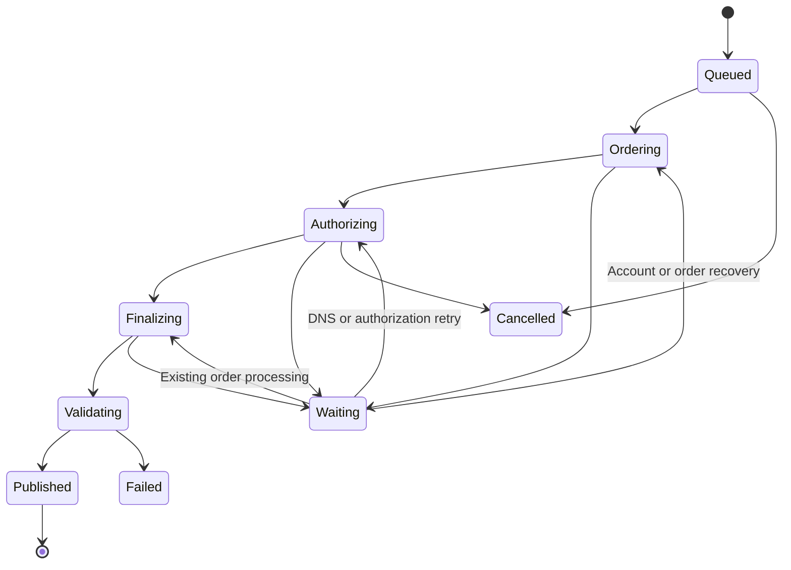

# SecretHub: Mozilla Trust Bundle and ACME DNS-01 Design

Status: proposed implementation design. No feature implementation or live issuance was performed during this review.

Date: 2026-10-22, Asia/Shanghai.

Repository: https://github.com/gsmlg-dev/secrethub

Reviewed baseline: `main` at `e1d09953bc1393e389e7fea1d03827c5358a5e1c`.

Companion documents: [implementation plan](secrethub-pki-acme-implementation-plan.md) and [Codex goal](secrethub-pki-acme-goal.md).

## 1. Outcome

SecretHub will include a Mozilla-derived TLS root CA bundle in every Core release and manage public server certificates through Let's Encrypt ACME v2, using DNS-01 with AWS Route 53 and Cloudflare.

The operator can inspect and export the default trust bundle, configure a DNS provider and an ACME account, request a certificate for DNS names, observe validation, and obtain a versioned certificate/key bundle. SecretHub renews configured certificates, recovers interrupted work, and cleans up its DNS records. Existing authorized Agent secret reads provide delivery to applications.

The implementation belongs in the existing Core, Shared, Web, and limited Agent integration boundaries. A new umbrella application is unnecessary.

### Scope of the first release

- Default `mozilla_webpki` catalogue and PEM export, available offline and independently of vault unsealing.
- Let's Encrypt production and staging accounts, DNS-01, individual DNS names, SAN sets, and wildcards.
- Route 53 and Cloudflare provider configurations with explicit zones and encrypted credential references.
- Durable issuance, retry, cancellation, DNS cleanup, renewal, and operator-requested revocation.
- Immutable certificate versions, exact-version private-key export, and an owned versioned static-secret projection.
- PKI management UI, lifecycle audit events, renewal/cleanup health, and deterministic integration tests.

The first release does not add an ACME server, HTTP-01 or TLS-ALPN-01 listeners, automatic service deployment, a general DNS editor, arbitrary public CAs/EAB, automatic account-key rollover, a runtime root-store download service, or new admin authentication. Separate-file certificate/key deployment is a later feature unless a real atomic generation publication primitive is implemented separately.

## 2. Findings in the current repository

These are source observations, not claims that the new feature exists.

| Current implementation | Consequence for this design |
| --- | --- |
| `PKI.CA` and `PKI.RootCA` select `:root_ca` and `:intermediate_ca` records as internal CA material. | Mozilla roots and downloaded ACME intermediates must never be inserted as those internal types. |
| `Certificate` is oriented around machine/client identities and has globally unique serial numbers. | Use separate public certificate version records, identified by canonical DER SHA-256, instead of expanding internal identity semantics. |
| `PKI.AppCertificates` issues application client identities and implements bootstrap/current-key proof renewal. | ACME server certificate issuance is a separate workflow; do not route it through app-client issuance. |
| Client Auth bundles contain a specific authority, CRL, pin, generation and receipt contract. | Keep `ClientAuth.TrustBundle` and `Agent.PKI.TrustBundleManager` scoped to internal client authentication. |
| Core depends on Oban and contains workers, but Core supervision does not start an Oban instance; the visible configured instance belongs to Human. | Add and verify a Core-owned named instance, migration and release configuration before relying on scheduled renewal. |
| Static secrets already provide encrypted values, material versions and transactional path revisions. | Publish a managed certificate as an owned static secret using the existing read/authorization contract. |
| `Sinker.write_multiple/2` performs individual file writes. | Per-file atomic rename does not establish an atomic certificate/key pair deployment. |
| Default single-operator features are `:static_secrets` and `:client_auth_pki`. | Integrate `:public_trust` and `:acme` explicitly; do not accidentally enable unrelated engines. |

Repository references: [internal CA selection][R1], [certificate schema][R2], [Core supervision][R3], [configuration][R4], [Client Auth bundle][R5], [Agent bundle manager][R6], [Secrets][R7], [Agent Sinker][R8], [launch profile][R9].

## 3. Ownership and trust boundaries

| Material | Purpose | Owner |
| --- | --- | --- |
| Mozilla public roots | Validate public TLS server identities and export an identified public trust bundle | `SecretHub.Core.PKI.TrustStores` |
| Internal CA keys and chains | Existing Agent/application/client-auth identity issuance and validation | Existing internal PKI contexts |
| ACME account key | Authenticate an account to a specific ACME directory | `SecretHub.Core.PKI.ACME.Accounts` |
| Leaf key and issued chain | Authenticate an application server for the requested DNS names | `SecretHub.Core.PKI.ManagedCertificates` |
| Provider credentials | Mutate explicitly configured DNS challenge records | `SecretHub.Core.PKI.DNS` and existing encrypted Secrets |

A public root certificate is trust material, not a signing capability. An ACME leaf is a server certificate, not a SecretHub machine identity. Adding this feature must not change who can connect to Agent runtime, bootstrap an application, or pass Caddy administration client-certificate verification.

Keep functional domain logic separate from effects: canonicalization, state transitions, renewal decisions, ownership checks and certificate validation are ordinary functions. Ecto transactions commit domain state; provider/ACME adapters perform bounded external operations; Oban schedules the next step. Avoid an in-memory process as the authoritative owner of an order.

## 4. Default Mozilla bundle

### Packaging and identity

Add `:castore` as an explicit runtime dependency of the Core app that uses it, and commit the resolved package in `mix.lock`. Use `CAStore.file_path/0` and the packaged PEM. CAStore is a small maintained packaging interface; its patch releases carry bundle updates. Do not rely on an optional transitive dependency or a build-machine CA path. [S1]

Expose a stable logical ID, `mozilla_webpki`, with immutable metadata:

- Root program/source: Mozilla/NSS; packaging provider: CAStore.
- Usage: TLS server authentication.
- Resolved package version and source date when available.
- SHA-256 over the exact exported PEM bytes, and parsed certificate count.
- Per-root DER SHA-256 fingerprint, subject, issuer, validity and public-key details.
- License/notice links and the SecretHub release carrying the snapshot.

The catalogue is derived once from the release artifact; it does not require importing roots into a database or creating a new trust administration subsystem. Keep public certificate details searchable/paginated in the PKI UI. Compute the PEM digest independently; do not assume a hash embedded in source-data comments identifies the emitted bytes.

### Availability and updates

An assembled release must provide the bundle with networking disabled and application files read-only. Public bundle reads do not need a vault master key. Validate nonempty PEM parsing during build/release checks and expose a clear unhealthy state if runtime material is corrupt. A failed public-trust operation never falls back to disabling TLS verification.

For v1, update through a reviewed CAStore dependency change and a normal SecretHub release. The new snapshot replaces old membership; never union removed roots back into the default. Display version/source date so stale deployments are identifiable. Review trust changes during rollback: rolling back a binary can also restore its older root snapshot. Do not silently substitute an older snapshot after a parse or verification failure.

Use the name “Mozilla-derived TLS root CA bundle.” PEM output does not reproduce every Firefox external name constraint, distrust policy or browser revocation mechanism. Normal PKIX path/hostname/usage/validity verification remains necessary. Full Firefox trust-policy emulation is outside scope. [S2]

### TLS use

Require explicit trust selection in the ACME and DNS HTTP adapters. Their public HTTPS connections use `mozilla_webpki`, peer verification and hostname checking. Do not modify global OTP SSL trust or append public roots to internal client-auth trust.

The staging ACME HTTPS endpoint also uses ordinary public HTTPS trust. For issued test certificates, ship a separately packaged `letsencrypt_staging_issuance` profile from the official staging roots, with reviewed source URLs and exact PEM/root fingerprints in a manifest. This profile is selectable only for staging-issued-chain validation; it is not an outbound HTTPS or internal identity default. Verify that it is present and valid before creating staging orders or DNS effects. Staging roots never enter `mozilla_webpki`, and staging certificate output cannot be silently promoted to a production managed resource. Pebble transport and issuance roots are separately injected by test configuration. [S3]

## 5. Public certificate model

Keep schemas under `secrethub_shared`; contexts and database migrations belong to Core. Names below are proposed contracts, not mandatory file naming.

| Record | Essential data and invariants |
| --- | --- |
| `AcmeAccount` | Directory/environment, account URL, contact, terms URL/acceptance time, account status, algorithm and encrypted account key. An account is scoped to one directory. |
| `DNSProvider` | Provider type, logical name, credential mode/reference, explicit allowed zone IDs and suffixes, enabled state and timeouts. Configuration is allowlisted public data. |
| `ManagedCertificate` | Stable ID/slug, normalized identifiers, account, per-domain provider bindings, key policy, configuration revision, enabled state, current version, next renewal and owned output secret. |
| `AcmeOrder` | Stable request ID/digest, managed resource/configuration revision, expected prior version, account/directory snapshot, remote URLs/state, CSR, encrypted pending leaf key, retry/deadline/claim data and redacted errors. |
| `AcmeAuthorization` | Remote authorization URL, identifier/wildcard flag, challenge URL, expiry and observed state; linked to its DNS operations. |
| `DNSChallengeOperation` | Durable intent ID, original/effective owner, provider account/zone identity, exact TXT value, ownership evidence, record/change IDs, attempt state and independent cleanup status. |
| `ManagedCertificateVersion` | Publication sequence, source order, environment, leaf fingerprint, public leaf/chain, SANs, actual validity, key metadata and exact output secret ID/material version. Lifecycle annotations track renewal info and revocation separately from immutable material. |

Use DB constraints for a unique managed slug, unique output-secret ownership, unique request scope/ID, one published version per order and appropriate active-order exclusivity. Enforce that a current version belongs to its managed resource. Do not assume serial numbers are globally unique across public issuers.

Keep three counters/identities distinct: `configuration_revision` changes with desired-state edits; `publication_sequence` advances for every successful issuance or renewal even without configuration edits; and `claim_token` identifies a bounded worker claim. The order ID supplies request/effect identity. A publishing order must match the intended configuration revision and expected prior active version as well as its current claim. Certificate bytes, key association, environment and secret-version reference are immutable; renewal observations and revocation state may evolve without rewriting that material.

Credentials refer to encrypted existing secrets; ACME account keys use the existing vault encryption primitives in typed storage. A pending order holds its encrypted leaf key so restart does not regenerate a different key/CSR. On publication, move the permanent key representation into the encrypted output secret and clear the pending copy in the same transaction. Public version metadata remains readable without decrypting the private key.

Existing `EngineConfiguration.config` is a plain map and is unsuitable for DNS tokens. Use only public provider parameters there if integrating any generic UI; actual credentials must remain encrypted. Jobs carry resource IDs, never account keys, provider tokens, decrypted secret maps, or PEM private keys.

## 6. Accounts, identifiers and provider binding

Support fixed production and staging directory presets. Production creation is an explicit operator choice; installation does not create an account, accept terms, or place an order. Persist operator-provided contact and terms acceptance. Account registration recovery reuses the persisted account key.

Normalize DNS identifiers before policy checks and order creation: IDNA to ASCII, lowercase, a consistent trailing-dot convention, deduplication, label/length validation and a single permitted leftmost wildcard. Reject IP identifiers and non-public/internal-only name forms for DNS-01. Private or absent service addresses are acceptable: requested identifiers must be valid names under publicly delegated DNS, and their effective DNS-01 TXT records must be publicly resolvable. Do not require public A/AAAA records or inbound HTTP/TLS reachability. [S4]

Bind each name or permitted suffix to an explicit provider configuration and public zone. Use label-aware longest-suffix matching; ambiguous bindings fail validation. Mixed SAN orders may use Route 53 for one name and Cloudflare for another. Snapshot effective bindings onto the order so a configuration edit does not redirect an outstanding cleanup operation.

Support configured challenge delegation: a mapping may specify the effective TXT owner/zone after a CNAME or NS delegation. Validate observed delegation, bound CNAME traversal, reject loops and require the final zone to be explicitly allowed. DNS discovery must not select arbitrary credentials. Challenge delegation is supported by Let's Encrypt. [S4]

Use ECDSA P-256 as the default leaf key policy and support RSA 2048 where needed. Keep account-key policy independent from leaf-key policy. Generate a new leaf key for a new issuance attempt; retries of the same durable order retain its original key.

## 7. Protocol adapter

Implement a narrow native ACME v2 adapter over a directly declared HTTP dependency and established JOSE/OTP/X509 primitives. Core already has Req-related packages in the umbrella lock, but must declare what it directly uses. Avoid hand-written cryptographic primitives and shell-driven certificate managers.

A bounded dependency check may select a current native client if its supported interfaces preserve external key ownership, persisted URL recovery, injectable transport/TLS trust, response headers, bounded retries and ARI. ExAcme's inspected documentation still lists renewal information as missing; installing it alone would not complete the lifecycle. If the compatibility check fails, proceed with the narrow adapter rather than stopping at a library survey. [S5]

Required protocol surface: directory/nonce, account register/recover, order create/read, authorization/challenge read, DNS-01 acknowledgment, CSR finalize, certificate-chain download, revocation and ARI. Correctness includes JWS headers/signing, POST-as-GET, nonce consumption, bounded `badNonce` recovery and ACME problem responses. DNS-01 TXT is the base64url SHA-256 digest of key authorization, not the raw key-authorization string. [S6]

Return status, relevant headers/Retry-After and normalized errors to the workflow. Disable generic automatic retries for mutating requests whose outcome is ambiguous; the workflow owns recovery. Limit transport time, response size, redirects and attempts. Validate remote URLs against the chosen ACME service policy; permit local Pebble endpoints only through explicit test configuration.

## 8. Durable issuance and publication

This is the local workflow. Preserve the CA's own order/authorization states separately. DNS cleanup has its own state and is not hidden by `Published`, `Failed` or `Cancelled`.

1. Validate configuration and allocate a durable local request. Repeating its idempotency ID with the same digest returns the existing order; a different digest conflicts.
2. Persist leaf key/CSR and remote-effect intent before creating an order. Persist remote URLs immediately when known. If a create response is lost, reconcile through supported account/order resources where possible; otherwise record the ambiguity, bound any replacement order and avoid claiming exactly-once remote issuance.
3. Read authorizations. Reused valid authorizations do not require DNS writes. For pending DNS-01 work, persist the exact TXT intent before contacting a provider.
4. Present records, reconcile ambiguous effects, record ownership evidence, and wait for DNS propagation. Never hold a database transaction through this wait.
5. Acknowledge each ready challenge and poll with persisted deadlines/retry timing. Both apex and wildcard values may be needed at the same owner. Do not clean up a value still needed by another live authorization.
6. Finalize only after the order is ready. Resume processing by reading the existing order; do not allocate a replacement because a worker restarted.
7. Download the issued chain and validate key match, requested SANs, server use, validity and expected trust/environment. Preserve the supplied usable intermediate chain; do not hardcode a Let's Encrypt intermediate or append the whole root bundle to fullchain output.
8. Publish one immutable version and its encrypted secret projection atomically. A stale configuration revision or expected prior version cannot replace newer desired/active state. Each successful renewal advances the publication sequence; a repeated completion creates no duplicate secret version.
9. Schedule owned DNS cleanup independently, including on failure, expiry or cancellation. Expose pending/failed cleanup even when the certificate is available.

Local cancellation abandons work and reconciles/cleans owned effects; it is not an invented ACME order-cancel API. A certificate obtained just before cancellation is retained as evidence but is not automatically published after the configuration revision is superseded.

## 9. DNS adapter contract

Each adapter provides bounded operations for zone validation, observation, presentation, ownership reconciliation and cleanup. The return value includes durable evidence; a bare success flag is insufficient.

An operation records whether material was created by this workflow, borrowed from a pre-existing matching record, or has ambiguous ownership. Borrowed records are never deleted. Values used by multiple local authorizations require shared ownership/refcount semantics or equivalent release eligibility checks.

Serialize record mutations across all Core nodes by provider account, zone, normalized owner and type. Use durable claims plus short, correctly scoped database locking. If a lock is session-scoped, pin its connection for that bounded critical section. The current `DistributedLock` uses separate pooled session-lock queries and must not be assumed safe for this purpose. Do not hold a connection through propagation polling. [R10]

DB fencing prevents stale publication; it does not fence DNS providers. A crashed or expired worker may have an in-flight remote request. Recovery must observe and reconcile before a new mutation; claims alone do not prove exactly-once effects. Reject unsupported recordset/routing shapes instead of flattening them.

### AWS Route 53

Use explicitly configured public hosted-zone IDs. Resolve credentials through a supported AWS credential chain/role or an encrypted secret reference, with temporary session tokens supported. Use an established SDK/signing implementation and test the HTTP adapter; the existing AWS STS/KMS placeholders are not a Route 53 implementation.

Route 53 changes operate on whole RRsets. Read the current plain TXT RRset and retain unrelated values and TTL. For an absent set, `CREATE` detects a competing creation. For an existing set, a conflict-aware exact `DELETE(observed)` plus `CREATE(merged)` transactional batch is the proposed guarded mutation, subject to adapter verification. Cleanup re-reads and subtracts only owned values; an empty remainder permits exact deletion. Do not restore an old snapshot or use a token-only unconditional UPSERT. The documented transactional and exact-delete semantics motivate this approach; they are not a generic ETag/CAS API guarantee. [S7]

Persist the change ID, handle pending zone changes/throttling, and wait for `GetChange` before DNS checks. Local serialization does not control external DNS writers; document ownership assumptions and validate conflicts against an isolated real test zone before relying on cross-writer behavior.

IAM should allow record reads/changes only on configured zones, change-status reads, and optional zone metadata reads. Limit record changes by TXT type, normalized challenge names and necessary actions. Prefer explicit zones so broad zone discovery permissions are unnecessary. Record-name conditions require their documented normalization. [S8]

### Cloudflare

Use an API token scoped to DNS Write/Edit on the configured zone. Add zone discovery/read permissions only if the selected metadata operation needs them; explicit zone IDs avoid broad discovery. Do not use a Global API Key.

Create individual TXT records, persist record ID/name/content and an operation marker, then clean up only an owned, unchanged record ID. Reconcile a timed-out create before retrying; an existing name alone proves no ownership. Do not delete all TXT records at an owner. Treat already-absent owned records as cleaned. Use supported TTL values, and never request proxying for TXT records. [S9]

### Propagation

API success is only an acknowledgment of a provider operation. Query authoritative DNS for the effective owner and verify all required values; optionally add public recursive checks. Account for negative caching and distinguish timeout from an authoritative mismatch. A local DNS observation cannot prove visibility at every CA vantage point, so use bounded configurable propagation polling and clear diagnostics. [S4]

## 10. Core scheduling and recovery

Create `SecretHub.Core.Oban`, bound to `SecretHub.Core.Repo`, with an installed-version-compatible jobs migration, Core supervision and explicit test/release configuration. Keep it separate from `SecretHub.Human.Oban`.

Use bounded queues for ACME progress and DNS cleanup, plus a periodic reconciler that finds due orders, due renewals, expired claims and cleanup debt. Jobs perform one bounded step and reschedule rather than sleeping through DNS propagation. Oban uniqueness is useful, but database invariants remain the authority for duplicate issuance and publication.

Vault-unavailable, credential-unavailable, DNS-delay, rate-limit and remote-processing states are resumable dependencies with visible next retry times. An exhausted worker attempt budget must not make an eligible renewal or cleanup obligation disappear; reconciliation owns recovery after explicit backoff. Never spin on permanent authorization/configuration failures.

Respect the actual vault contract. The reviewed implementation's manual seal operation is not a reliable worker-revocation switch; do not claim it is. Acquire private material through the existing availability checks for each bounded effect and avoid long-lived decrypted state. Redact remote response bodies before storing diagnostics.

Enable public trust by default. Make ACME available through a deliberate `:acme` launch feature, with zero external issuance until resources are configured/enabled. Disabling ACME, a provider or a managed resource stops new issuance/renewal and new publication, while already-owned reconciliation, DNS cleanup and pending revocation remain eligible to finish. Retain the original bindings and credential references until those obligations are resolved; do not permit configuration deletion to orphan them. If credentials themselves are unavailable, expose blocked cleanup and retry after recovery. Update runtime configuration, UI mappings, Core entry-point checks, workers and release tests together. This must not activate dormant generic rotation or dynamic engines. [R9], [R11]

## 11. Renewal and revocation

Use ARI when the directory advertises renewal information. Persist the certificate identifier, fetched window, chosen randomized renewal point, refresh timing and replacement relation. Respect server refresh instructions, validate windows, and stop polling replaced/expired generations. [S10]

When ARI is absent or unusable, derive renewal from the certificate's actual notBefore/notAfter: approximately two-thirds through its lifetime, or halfway for certificates shorter than ten days, with persisted jitter and an expiry safety bound. Manual renewal bypasses normal scheduling, not concurrency, provider scope or rate-limit protections. [S11]

This matters immediately: Let's Encrypt announced a production default of 64 days from 2027-02-10 and switched staging on 2026-10-14. Do not assume a 90-day certificate or a fixed 30-day renewal interval. Tests must cover differing lifetimes. [S12]

Keep the current valid certificate available while a replacement attempt fails. Publication is the only operation that switches the active generation. Renewal health must distinguish a valid serving version with a failing replacement from an expired or revoked version.

Operator-requested revocation has pending/confirmed/failed remote states. Quarantine the selected version from new private-material exports/delivery immediately, while marking remote revocation confirmed only after ACME acknowledgment or verified already-revoked state. Ambiguous or failed remote requests retain local quarantine and visible retry/recovery state.

Apply the gate to the resolved immutable version: current-secret reads check the current managed version; historical reads and exact-version exports check the selected historical version. Revoking an older version must not block a newer healthy current version. An available current version must not bypass a historical version's quarantine. On active availability changes, update the normal secret row/path revision atomically and enforce the gate before returning cache `not_modified`. Public certificate history may remain readable without key material. Revocation cannot recall bytes already distributed or force another application to reload.

## 12. Transactional secret publication and delivery

Reserve one owned static secret such as `pki.acme.<slug>`. Dotted paths match the current schema. Keep `secret_type = static` and `engine_type = static`; do not pretend an `acme` secret engine already exists. The encrypted payload contains the leaf, chain, fullchain, private key, certificate-version ID, fingerprint and validity from one generation. [R7], [R12]

There are three different version concepts:

| Value | Meaning |
| --- | --- |
| `secrets.version` | Current material revision |
| `(secret_id, secret_versions.version_number)` | A historical material revision; current material is not yet a historical row |
| `secret_path_revisions.revision` | Cache/authorization revision maintained by triggers |

Store exact output secret ID and material version on the managed version. Do not use the currently unmaintained `Secret.current_version_id` association. An exact-version resolver checks current material first, then historical snapshots, and verifies the embedded certificate-version ID/fingerprint. It never substitutes the newest private key for an older certificate.

Extract only the required database steps from the existing Secrets create/update implementation into a composable helper. In one short caller-owned transaction: acquire the existing authorization lock in its established order; lock/check the managed resource and output; archive old material; write the new encrypted payload; insert/link the immutable public version; switch the current pointer; mark the order published; clear the pending key; and append checked publication audit evidence. Notify consumers only after commit. The order ID and uniqueness checks make replay a no-op. Preserve the existing trigger-based revision contract. [R7], [R13]

Ownership is an authoritative unique relation, not editable metadata. Generic secret value update, rollback, deletion, rotation or history pruning must not desynchronize the projection. Preserve policy management and authorized reads. Retained managed versions pin their referenced history; deleting history requires a coordinated managed retention operation. Avoid a second cache invalidation system.

V1 delivery consists of management export from a specific version and existing authorized Agent reads of the structured secret. A consumer reads the bundle once and renders matching fields together. Demonstrate the existing single-file sink with a combined PEM for a compatible consumer. Do not claim `write_multiple/2` is an atomic separate-file deployment; a later versioned-directory/current-pointer sink can provide that contract. No arbitrary remote deployment or automatic Caddy configuration replacement is needed.

## 13. API and UI

Keep management actions on the current private management Endpoint behind Caddy mTLS, using existing admin/CSRF protection. No new admin user system, login or sessions are introduced. Machine consumers continue through existing authenticated secret reads; do not copy provider/account/order mutations into `MachineRouter`. [R14]

Proposed management resources:

| Resource group | Operations |
| --- | --- |
| Trust stores | List, inspect version/roots, download public PEM |
| DNS providers | Create/edit/disable, inspect allowed zones, credential-reference status, read-only configuration check |
| ACME accounts | Configure/register, inspect environment/status/terms, disable |
| Managed certificates | Create/update, issue/renew, pause/resume, list versions, export chosen version, request revocation |
| Orders | Inspect phase, validation/propagation, retries, redacted failure, local cancellation |
| Cleanup | Inspect owned outstanding records, retry reconciliation/cleanup |

Suggested route families are `/admin/pki/trust-stores`, `/admin/pki/acme`, and `/admin/api/pki/...`, subject to existing naming conventions. Mutations return a durable resource/job identifier and do not block a LiveView or HTTP request through validation. Private exports use explicit protected requests and `Cache-Control: no-store`; listing and ordinary detail views never serialize private keys.

Add focused LiveViews/components instead of extending the already large `PKIManagementLive` with the entire ACME workflow. Show staging/production clearly, current version and remaining validity, next renewal, latest failure, and DNS cleanup status. A completed issuance and a completed deployment are different statuses; v1 does not claim automatic deployment.

Audit account/provider changes, issuance requests/results, publication, renewal, revocation, credential-reference changes and cleanup outcomes. Existing `PKI.Events` requires an internal `ca_id`; use the general Audit subsystem and order state rather than fabricating a local CA to fit that schema. [R15]

## 14. Verification and operational boundary

Required development gates include offline bundle availability, exact exported hash, release packaging, explicit public/internal trust isolation, encrypted key handling, protocol correctness against Pebble, provider HTTP contract tests, same-owner challenge concurrency, ambiguous-response recovery, restart recovery, cleanup, renewal and atomic secret publication.

Include regressions for current internal CA/app certificates/client-auth bundles, management/machine route separation and cache authorization. A valid public server certificate must still fail SecretHub machine/client identity admission. Also test two renewals without configuration edits, an edit racing publication, disable immediately after TXT creation, and historical-versus-current revocation isolation. A missing staging profile fails before external effects.

Live staging tests use separate disposable domains/zones and real credentials supplied by the operator. Run one issuance/cleanup/renewal path through each provider before declaring that provider operationally validated. Missing credentials must not stop implementation or deterministic tests; report that live staging gate as not run. No production certificate is requested simply to test the code. Pebble is an ACME test server, not evidence that AWS or Cloudflare was exercised. [S13]

Backups cover the database and existing vault recovery material together. Recovery must retain account keys, pending order keys, output secret history, remote URLs and outstanding DNS ownership receipts. Restore should resume/reconcile outstanding work rather than immediately duplicate issuance.

## 15. Design decisions to retain

1. Public trust, internal identity and external issuance are separate responsibilities.
2. The default Mozilla bundle is a reproducible release artifact; a runtime updater is not required for v1.
3. PostgreSQL is the authority for certificate workflow and ownership; processes/jobs are replaceable executors.
4. External effects are at-least-once attempts with reconciliation, not fictional exactly-once transactions.
5. A managed certificate is a stable resource pointing at an immutable version; secret publication moves the pointer and material together.
6. DNS cleanup and renewal remain visible obligations after worker or process failure.
7. Production readiness is supported by evidence from the actual release and providers, separately from planned behavior and mocked tests.

## Sources

All repository links below identify the reviewed commit. External documentation was checked on 2026-10-22; recheck changing API details during implementation.

[R1]: https://github.com/gsmlg-dev/secrethub/blob/e1d09953bc1393e389e7fea1d03827c5358a5e1c/apps/secrethub_core/lib/secrethub_core/pki/ca.ex
[R2]: https://github.com/gsmlg-dev/secrethub/blob/e1d09953bc1393e389e7fea1d03827c5358a5e1c/apps/secrethub_shared/lib/secrethub_shared/schemas/certificate.ex
[R3]: https://github.com/gsmlg-dev/secrethub/blob/e1d09953bc1393e389e7fea1d03827c5358a5e1c/apps/secrethub_core/lib/secrethub_core/application.ex
[R4]: https://github.com/gsmlg-dev/secrethub/blob/e1d09953bc1393e389e7fea1d03827c5358a5e1c/config/config.exs
[R5]: https://github.com/gsmlg-dev/secrethub/blob/e1d09953bc1393e389e7fea1d03827c5358a5e1c/apps/secrethub_core/lib/secrethub_core/pki/client_auth/trust_bundle.ex
[R6]: https://github.com/gsmlg-dev/secrethub/blob/e1d09953bc1393e389e7fea1d03827c5358a5e1c/apps/secrethub_agent/lib/secrethub_agent/pki/trust_bundle_manager.ex
[R7]: https://github.com/gsmlg-dev/secrethub/blob/e1d09953bc1393e389e7fea1d03827c5358a5e1c/apps/secrethub_core/lib/secrethub_core/secrets.ex
[R8]: https://github.com/gsmlg-dev/secrethub/blob/e1d09953bc1393e389e7fea1d03827c5358a5e1c/apps/secrethub_agent/lib/secrethub_agent/sinker.ex
[R9]: https://github.com/gsmlg-dev/secrethub/blob/e1d09953bc1393e389e7fea1d03827c5358a5e1c/apps/secrethub_shared/lib/secrethub_shared/launch_profile.ex
[R10]: https://github.com/gsmlg-dev/secrethub/blob/e1d09953bc1393e389e7fea1d03827c5358a5e1c/apps/secrethub_core/lib/secrethub_core/distributed_lock.ex
[R11]: https://github.com/gsmlg-dev/secrethub/blob/e1d09953bc1393e389e7fea1d03827c5358a5e1c/config/core_runtime.exs
[R12]: https://github.com/gsmlg-dev/secrethub/blob/e1d09953bc1393e389e7fea1d03827c5358a5e1c/apps/secrethub_shared/lib/secrethub_shared/schemas/secret.ex
[R13]: https://github.com/gsmlg-dev/secrethub/blob/e1d09953bc1393e389e7fea1d03827c5358a5e1c/apps/secrethub_core/priv/repo/migrations/20261001000004_create_secret_path_revisions.exs
[R14]: https://github.com/gsmlg-dev/secrethub/blob/e1d09953bc1393e389e7fea1d03827c5358a5e1c/apps/secrethub_web/lib/secret_hub/web/router.ex
[R15]: https://github.com/gsmlg-dev/secrethub/blob/e1d09953bc1393e389e7fea1d03827c5358a5e1c/apps/secrethub_core/lib/secrethub_core/pki/events.ex
[S1]: https://github.com/elixir-mint/castore/blob/main/README.md
[S2]: https://curl.se/docs/caextract.html
[S3]: https://letsencrypt.org/docs/staging-environment/
[S4]: https://letsencrypt.org/docs/challenge-types/
[S5]: https://ex-acme.hexdocs.pm/readme.html
[S6]: https://www.rfc-editor.org/rfc/rfc8555.html
[S7]: https://docs.aws.amazon.com/Route53/latest/APIReference/API_ChangeResourceRecordSets.html
[S8]: https://docs.aws.amazon.com/Route53/latest/DeveloperGuide/specifying-conditions-route53.html
[S9]: https://developers.cloudflare.com/api/resources/dns/subresources/records/methods/create/
[S10]: https://www.rfc-editor.org/rfc/rfc9773.html
[S11]: https://letsencrypt.org/docs/integration-guide/
[S12]: https://letsencrypt.org/2026/10/07/64-day-certs
[S13]: https://github.com/letsencrypt/pebble
